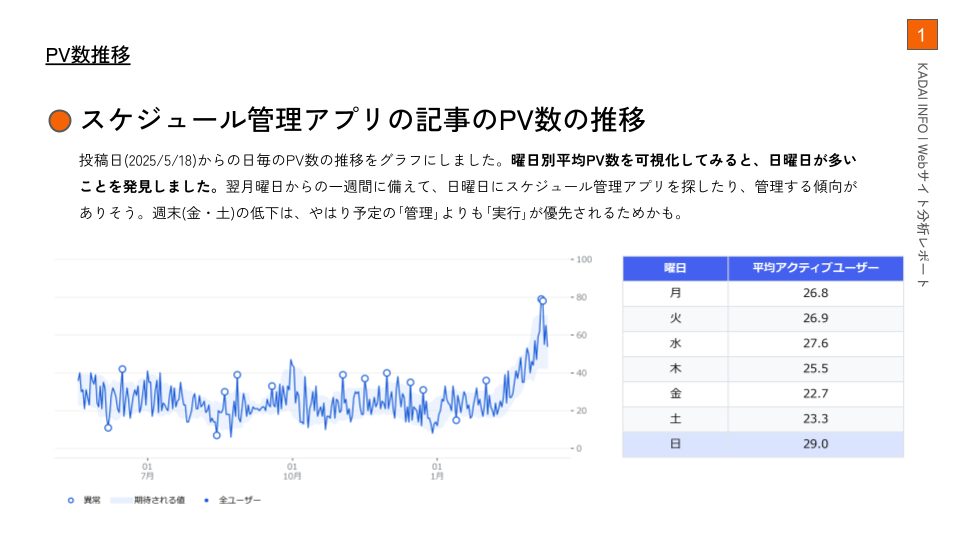
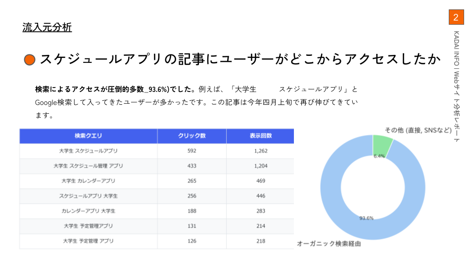

<h1 align="center">こんにちは、kaitolim7です 👋🏻</h1>

  鹿児島大学で統計学を学んでいます。 
  データから新しい価値や意思決定につながるインサイトを見つけることに興味があります。

---

## 👨🏻‍💻 About Me

- 👨🏻‍🎓 鹿児島大学の学生です。九州大学院システム情報科学府に合格しました。
- 📊 多変量解析を専攻しています。
- 🧮 数理統計を基礎として、データの背後にある構造や関係性を分析しています。
- 🤖 機械学習・深層学習・推薦アルゴリズムにも興味があります。。

## 🔬 成果
webメディアKADAI INFOのレコメンドエンジン(記事の推薦モデル)の開発

記事のデータ分析も行っています

 
 
 
 

## 🏅 Certifications

- IBM Data Science Professional Certificate

## 🛠️ Skills

  
  
  
  
  
  
  
  
  

## 🎯 Currently Learning

- 統計モデルと機械学習モデルの理論・実装
- 脳波分類のモデル開発・投資戦略のモデル開発
- ユーザーの閲覧履歴から記事を推薦するシステム
- 高次元かつ複雑な現象分析に有効に機能する解析手法
- 極値統計学
- 世界モデル(状態空間モデル)

---

